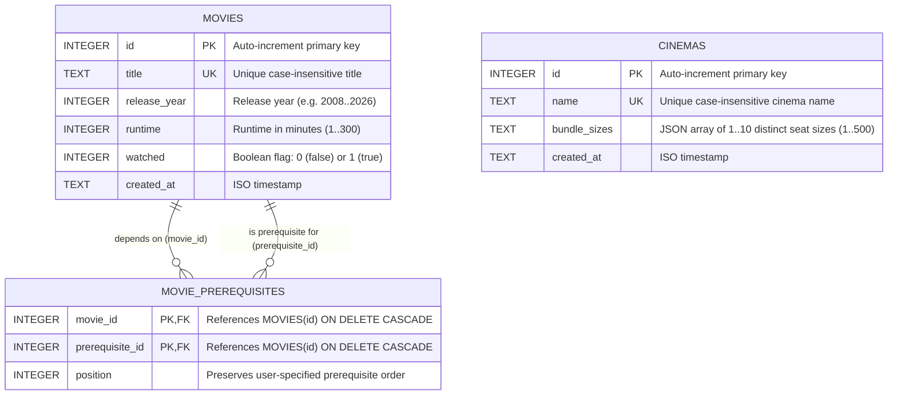

# Doomsday Ready — MCU Rewatch Planner & Watch-Party Booking

**Doomsday Ready** is a full-stack web application built for the **Blinto Talent Accelerator 2027 — Full Stack Developer Internship Assessment**. It helps Marvel Cinematic Universe (MCU) fans plan their prerequisite movie rewatch order before *Avengers: Doomsday* and calculate the optimal opening-night seat bundle combinations for their watch party.

---

## Quick Start

### Option 1: Docker Compose (One Command — Bonus)

```bash
docker compose up --build
```

- **Frontend UI**: http://localhost:5173
- **Backend API**: http://localhost:4000/api

### Option 2: Local Development (Node.js 22.5+ / 24+)

1. **Install dependencies**:
   ```bash
   npm run install:all
   ```
2. **Run automated unit & API tests**:
   ```bash
   npm test
   ```
3. **Start both Backend (`http://localhost:4000`) and React Frontend (`http://localhost:5173`) in one command**:
   ```bash
   npm run dev
   ```
   *(Or run `npm run dev:backend` and `npm run dev:frontend` in two separate terminals, or `npm run build && npm start` to serve both API and production React build from `http://localhost:4000`.)*

---

## Data Model Diagram (Bonus)

The application uses **SQLite** (via Node's built-in `node:sqlite`) with three relational tables: `movies`, `movie_prerequisites` (representing the Directed Acyclic Graph edges between movies and the prerequisites you must watch first), and `cinemas`.



---

## Core Algorithms (Written From Scratch, Zero External Solver Libraries)

### Feature 1: Circular Dependency Detection & Topological Rewatch Order
Implemented in [`backend/src/algorithms/rewatchOrder.ts`](backend/src/algorithms/rewatchOrder.ts):

1. **Cycle Detection (`detectCircularDependency`)**:
   - Uses **3-color Depth-First Search (DFS)** (`0 = UNVISITED`, `1 = VISITING` in the active recursion stack, `2 = VISITED` and verified cycle-free).
   - Before any `POST /api/movies` or `PATCH /api/movies/:id` is committed, the proposed prerequisite edges are tested. If a back-edge to a `VISITING` ancestor is found (including a direct self-loop), the request is immediately rejected with HTTP **`409`** and `{ "error": "CIRCULAR_DEPENDENCY", "code": "CIRCULAR_DEPENDENCY" }`.
   - Time Complexity: $O(V + E)$ where $V$ is the number of movies and $E$ is the number of prerequisite links.

2. **Rewatch Order (`computeRewatchOrder`)**:
   - Given a target movie $T$, performs a **post-order DFS traversal** starting from each direct prerequisite of $T$.
   - For every reachable prerequisite movie $u$, all of $u$'s prerequisites are recursively visited and emitted **before** $u$ itself is appended to the result list, and a `visited` set guarantees every ancestor appears **exactly once**.
   - The target movie $T$ itself is excluded.
   - Simultaneously computes `watchedCount` (how many prerequisite movies are marked watched) and `unwatchedRuntime` (total runtime in minutes of all unwatched prerequisite movies).
   - Time Complexity: $O(V + E)$.

### Feature 2: Minimum Seat Bundle Booking Quote
Implemented in [`backend/src/algorithms/bookingQuote.ts`](backend/src/algorithms/bookingQuote.ts):

- **Problem**: Given a cinema's bundle sizes $B = \{b_1, b_2, \dots, b_k\}$ ($1 \le k \le 10$, $1 \le b_i \le 500$) and a `groupSize` $G$ ($1 \le G \le 10,000$), find the fewest bundles whose seats sum to **exactly** $G$, and how many of each bundle size to buy.
- **Why Greedy Fails**: For bundle sizes `[1, 3, 4]` and group size `6`, a greedy approach picks `4 + 1 + 1` (3 bundles), whereas the optimal exact solution is `3 × 2` (2 bundles). Similarly, for `[2, 5]` and group size `11`, greedy `5 × 2 = 10` leaves `1` seat unsolved, whereas `5 × 1 + 2 × 3 = 11` solves it in 4 bundles.
- **Bottom-Up Dynamic Programming (`computeBookingQuote`)**:
  - Allocates `dp[0..G]` initialized to $\infty$ with `dp[0] = 0`, and `choice[0..G]` to record the chosen bundle size at each seat count.
  - Sorts bundle sizes in descending order so larger bundles are naturally preferred on ties.
  - For each seat sum $s \in [1, G]$ and each bundle size $b \in B$:
    $$\text{if } s \ge b \text{ and } dp[s - b] + 1 < dp[s]: \quad dp[s] = dp[s - b] + 1, \quad choice[s] = b$$
  - If $dp[G] = \infty$, returns `possible: false` (`"Not possible"`). Otherwise backtracks from $G$ to $0$ using `choice` to reconstruct the exact count of each bundle size.
  - Time Complexity: $O(G \cdot |B|) \le 10,000 \times 10 = 10^5$ operations (< 1 ms). Space Complexity: $O(G)$.

---

## API Reference

All endpoints are mounted under `/api`:

| Method & Path | Purpose |
| :--- | :--- |
| `POST /api/movies` | Create a movie (`title`, `releaseYear`, `runtime` 1–300, `watched`, `prerequisites`). Rejects cycles with `409 CIRCULAR_DEPENDENCY`. |
| `GET /api/movies` | List all movies with their prerequisite IDs and watched state. |
| `PATCH /api/movies/:id` | Update a movie, including `watched` and `prerequisites`. Rejects cycles with `409 CIRCULAR_DEPENDENCY`. |
| `GET /api/movies/:id/rewatch-order` | Compute topological rewatch order (excluding target), watched count, and unwatched runtime. |
| `POST /api/cinemas` | Create a cinema (`name`, `bundleSizes` array of 1–10 distinct sizes, each 1–500 seats). |
| `GET /api/cinemas` | List all cinemas and their bundle sizes. |
| `GET /api/cinemas/:id/booking?groupSize=6` | Compute fewest bundles adding up to exact `groupSize` (1–10,000) or `"Not possible"`. |
| `POST /api/seed/reset` | Reset database to the assessment's canonical sample MCU movies and test cinemas. |

---

## Design Decisions & Assumptions

1. **Pre-Seeded Assessment Sample Data**: On first startup (when the SQLite database is empty), the backend automatically seeds the 8 MCU movies from the specification (*Iron Man*, *Captain America: The First Avenger*, *The Avengers*, *Captain America: Civil War*, *Thor: Ragnarok*, *Avengers: Infinity War*, *Avengers: Endgame*, *Avengers: Doomsday*) and the 4 test cinemas (`[1, 3, 4]`, `[2, 5]`, `[6, 9, 20]`, `[4, 6]`). A **"Reset Sample Data"** button in the header lets evaluators restore this baseline at any time.
2. **Initial Watched State in Sample Data**: The first 4 chronologically earlier MCU movies are pre-marked as watched (`4 of 7 watched` for *Avengers: Doomsday*, matching the PDF's `"for example '4 of 7 watched'"` illustration in Feature 3). Every movie's watched state can be toggled at any time in either the **Movies** view or the **Rewatch Plan** view.
3. **Flexible Prerequisite Input**: `POST /api/movies` and `PATCH /api/movies/:id` accept prerequisite references either as numeric movie IDs (e.g., `[1, 2]`) or as exact movie title strings (e.g., `["Iron Man"]`).
4. **Validation Error Codes**:
   - Circular dependencies always return HTTP `409` with `{ "error": "CIRCULAR_DEPENDENCY", "code": "CIRCULAR_DEPENDENCY", "message": "..." }`.
   - Duplicate movie titles or cinema names return HTTP `409`.
   - Out-of-range inputs (movie runtime outside `1–300`, bundle count outside `1–10`, bundle size outside `1–500`, or `groupSize` outside `1–10,000`) return HTTP `400`.

---
