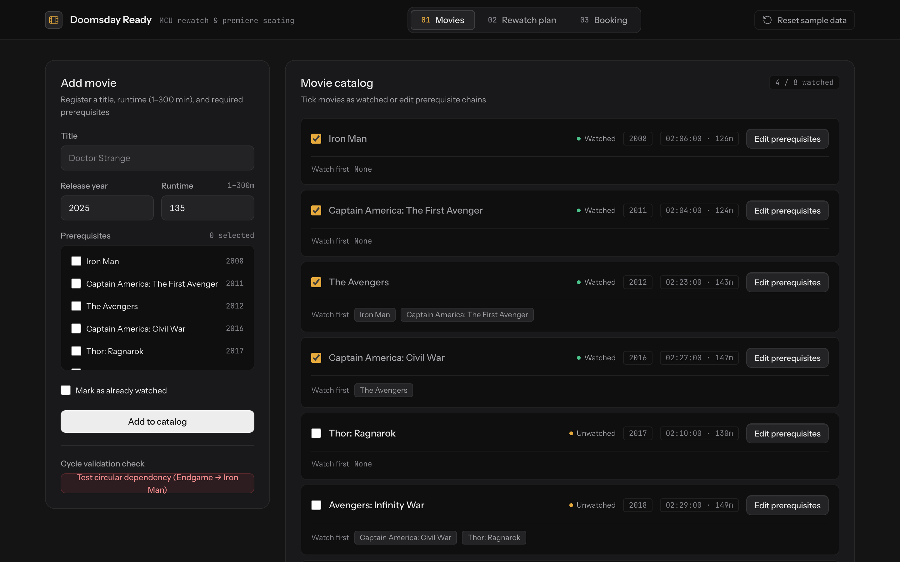
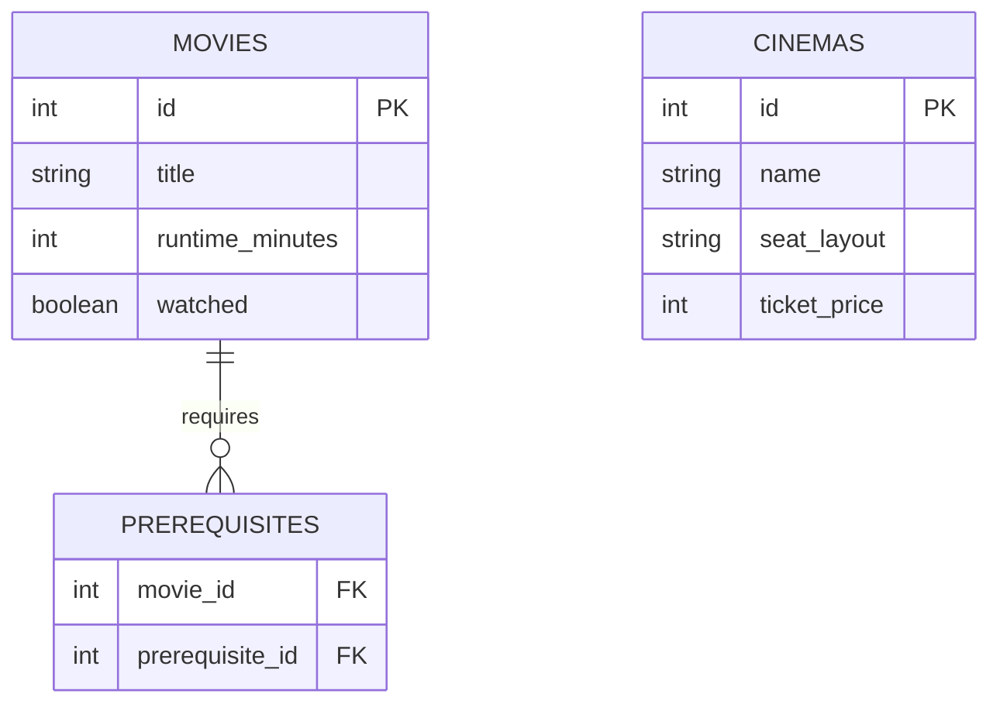

# Doomsday Ready

**MCU Rewatch Planner & Opening-Night Watch-Party Booking Platform**


A full-stack scheduling and cinema watch-party booking platform for organizing an MCU rewatch ahead of opening night. It models movie prerequisite dependencies as a Directed Acyclic Graph (DAG), validates cycles with 3-color DFS, computes valid rewatch orders with topological sorting, and optimizes group seat allocation using dynamic programming.

---

## Screenshots



---

## Architecture & Algorithms



- **Cycle Detection (3-Color DFS)**: Rejects circular prerequisite chains on mutation with `409 CIRCULAR_DEPENDENCY`.
- **Topological Rewatch Order**: Produces deterministic rewatch schedules respecting movie dependencies and watched state.
- **Seat Bundle Optimization (Bottom-Up DP)**: `computeBookingQuote` evaluates contiguous/grouped seat blocks via `/booking?groupSize=` to compute optimal watch-party seating quotes.

---

## Core Features

- **Rewatch Catalog & Progress Tracking**: Track watched status (`4 / 8 watched` and beyond) across seeded MCU titles with instant reset support (`/api/seed/reset`).
- **Dependency Graph Validation**: Add or edit prerequisite links with server-side cycle prevention (`409 CIRCULAR_DEPENDENCY`).
- **Topological Rewatch Planner**: Generate step-by-step viewing order via `/rewatch-order`.
- **Watch-Party Cinema Booking**: Query cinemas (`/api/cinemas`) and compute optimal group seating quotes (`/booking?groupSize=`).
- **Automated Test Suite**: Algorithm and API integration tests written with TypeScript and Node's native test runner (`node --test`).
- **Containerized Deployment**: Multi-service `docker-compose.yml` with Nginx-served React frontend and Express backend.

---

## Tech Stack

| Layer | Technology |
| :--- | :--- |
| **Frontend** | React 18, TypeScript 5.7, Vite 6 |
| **Backend** | Node.js (native `node:sqlite`), Express 4.21, CORS, TypeScript (`tsx`) |
| **Database** | Embedded SQLite (`backend/data/doomsday.db`) |
| **Testing** | Node native test runner (`node --import tsx --test tests/*.test.ts`) |
| **Deployment** | Docker, Docker Compose, Nginx (`frontend/nginx.conf`) |

---

## API Reference

| Method | Endpoint | Description |
| :--- | :--- | :--- |
| `GET` | `/api/movies` | List all movies with watched state and prerequisites |
| `POST` | `/api/movies` | Create a new movie or prerequisite link (3-color DFS validated) |
| `PATCH` | `/api/movies/:id` | Update watched status or movie metadata |
| `GET` | `/rewatch-order` | Compute topological rewatch sequence |
| `GET` | `/api/cinemas` | List cinema halls and seat configurations |
| `GET` | `/booking?groupSize=` | Compute optimal DP seat bundle quote (`computeBookingQuote`) |
| `POST` | `/api/seed/reset` | Reset SQLite database to initial seeded state |

---

## Project Structure

```text
Doomsday-Ready-Blinto-/
├── backend/
│   ├── data/doomsday.db         # Embedded SQLite database
│   ├── src/
│   │   ├── algorithms/          # 3-color DFS, topological sort, DP seat quote
│   │   ├── routes/              # Express API route handlers
│   │   ├── app.ts               # Express app configuration
│   │   ├── db.ts                # node:sqlite connection & schema setup
│   │   ├── index.ts             # Server entry point
│   │   └── types.ts             # Shared TypeScript interfaces
│   ├── tests/
│   │   ├── algorithms.test.ts   # Graph & DP algorithm unit tests
│   │   └── api.test.ts          # Express API integration tests
│   ├── Dockerfile
│   └── package.json
├── frontend/
│   ├── src/
│   │   ├── algorithms/          # Client-side scheduling helpers
│   │   ├── components/          # UI views & booking controls
│   │   ├── api.ts               # Backend API client
│   │   ├── standaloneStore.ts   # Fallback client store
│   │   └── App.tsx
│   ├── Dockerfile
│   ├── nginx.conf
│   └── package.json
├── docker-compose.yml
└── package.json                 # Root workspace scripts
```

---

## Local Setup

### Prerequisites

- Node.js 22+ (required for built-in `node:sqlite`)
- npm

### Installation & Run

```bash
git clone https://github.com/IFTI-KAR/Doomsday-Ready-Blinto-.git
cd Doomsday-Ready-Blinto-

# Install backend & frontend dependencies
npm run install:all

# Start both backend (:4000) and frontend (:5173) concurrently
npm run dev
```

### Running Tests & Docker

```bash
# Run algorithm & API test suite
npm test

# Or run the full stack via Docker Compose
docker compose up --build
```
